# Secrets Management on Amazon EKS with HashiCorp Vault, AWS KMS Auto-Unseal and Aurora Serverless v2

**Multi-environment deployments with Kustomize and Helm, and zero hardcoded database credentials.**

A PHP tooling application runs on Amazon EKS in three environments (dev, sit and prod), each defined as a Kustomize overlay on one shared base. HashiCorp Vault runs in High Availability mode with integrated Raft storage, installed from the official Helm chart. Every environment receives its database credentials from Vault at runtime through the Vault Agent Injector, so no credentials exist in the manifests or as Kubernetes Secrets. Vault auto-unseals with AWS KMS through an IRSA role, the database is Aurora Serverless v2, the image is stored in Amazon ECR, and all AWS infrastructure is provisioned with Terraform.

## Table of Contents

1. [Architecture](#architecture)
2. [Tools and Versions](#tools-and-versions)
3. [Repository Structure](#repository-structure)
4. [How the Environments Are Built](#how-the-environments-are-built)
5. [Vault Design](#vault-design)
6. [Security Model](#security-model)
7. [AWS Infrastructure](#aws-infrastructure)
8. [Evidence](#evidence)
9. [Running the Project](#running-the-project)
10. [Design Decisions](#design-decisions)
11. [Challenges and How I Solved Them](#challenges-and-how-i-solved-them)
12. [Outdated Documentation Pitfalls](#outdated-documentation-pitfalls)
13. [Lab Limitations and Production Changes](#lab-limitations-and-production-changes)
14. [Cost and Teardown](#cost-and-teardown)
15. [Key Takeaways](#key-takeaways)

## Architecture

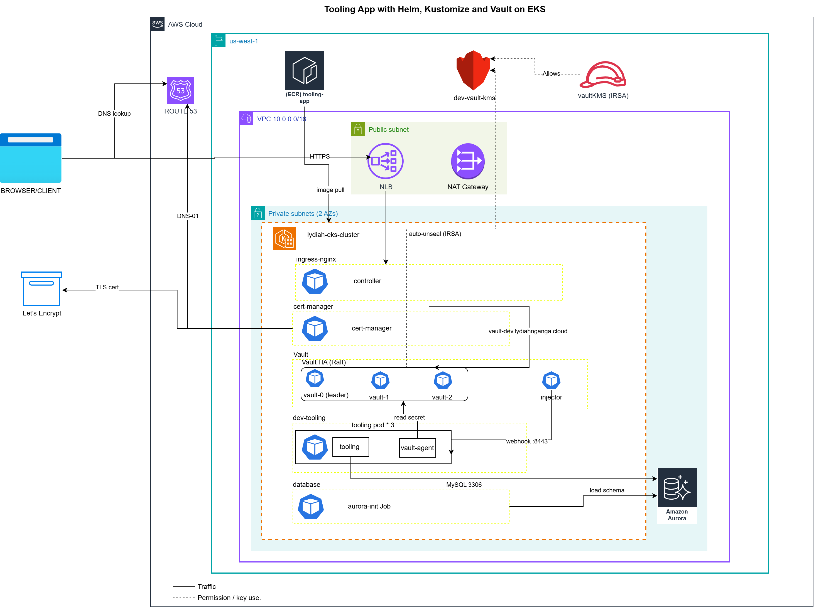

**How traffic and permissions flow**

1. The browser resolves `vault-dev.lydiahnganga.cloud` through Route 53 and connects over HTTPS to a Network Load Balancer.
2. The NLB forwards to the ingress-nginx controller, which routes to the Vault HA (Raft) cluster.
3. cert-manager proves domain ownership to Let's Encrypt with a Route 53 DNS-01 challenge and keeps the TLS certificate renewed.
4. Vault auto-unseals with the `dev-vault-kms` key. The `vaultKMS` IAM role (IRSA) is what allows the Vault pods to use that key.
5. When a tooling pod is created, the Vault Agent Injector webhook (port 8443) adds a `vault-agent` sidecar.
6. The sidecar logs in to Vault with the pod's Kubernetes service account and reads that environment's database credentials.
7. The tooling container uses those credentials to connect to Aurora on port 3306.
8. The aurora-init Job creates one database and user per environment and loads the schema.
9. EKS nodes pull the tooling image from Amazon ECR.

The diagram's editable source is embedded in the PNG and can be opened directly in draw.io.

## Tools and Versions

| Tool | Version | Notes |
|---|---|---|
| Amazon EKS | 1.32 | Cluster reused from Project 24 (see [limitations](#lab-limitations-and-production-changes)) |
| kind | 0.33.0 | Local cluster used to build and test before AWS |
| kubectl with built-in Kustomize | 1.36.1 / 5.8.1 | `kubectl kustomize --enable-helm` renders Helm charts |
| Helm | 4.3.1 | |
| Vault Helm chart | 0.34.1 (Vault 2.0.4) | Agent Injector 1.7.6 |
| Aurora MySQL | 8.0.mysql_aurora.3.10.6 | Serverless v2 with scale to zero |
| MySQL | 8.4 LTS | Local stand-in for Aurora on kind |
| Terraform | 1.14.7 | AWS provider 5.100 |
| cert-manager | via Project 26 Terraform | ClusterIssuer `letsencrypt-prod` |
| ingress-nginx | latest chart | Exposed through an NLB |

## Repository Structure

```
Project-27-Helm-Kustomize-Vault/
├── deploy.sh                       # renders an overlay and fills in the AWS account ID
├── kind-config.yaml
├── ingress-nginx-values.yaml
├── tooling-app-kustomize/
│   ├── base/                       # Deployment (probes, security context), Service
│   └── overlays/{dev,sit,prod}/    # replicas, resources, image tag, Vault annotations, tooling-sa
├── vault/
│   ├── bootstrap.sh                # idempotent Vault configuration
│   ├── policies/                   # tooling-dev, tooling-sit, tooling-prod, vault-admin
│   ├── base/
│   └── overlays/
│       ├── local/                  # kind: Shamir unseal, single replica
│       └── {dev,sit,prod}/         # EKS: KMS seal, ingress and TLS, IRSA
├── database/
│   ├── (local MySQL)               # kind only
│   └── aurora/                     # Kubernetes Job that initialises Aurora
└── terraform/
    ├── kms.tf  iam.tf  ecr.tf  aurora.tf  ...
    └── state-bucket/               # S3 state bucket policy and lifecycle rule
```

Real values never enter Git. Each file that needs them has a committed `.example` version with placeholders (`database/.env.example`, `database/aurora/aurora.env.example`, `vault/overlays/*/.env.example`). Vault init keys, generated Helm `charts/`, `.terraform/` and plan files are ignored.

## How the Environments Are Built

One base holds the Deployment and Service. Each overlay only describes what is different for its environment:

| | dev | sit | prod |
|---|---|---|---|
| Replicas | 3 | 2 | 3 |
| CPU request / limit | 250m / 500m | 250m / 500m | 300m / 600m |
| Memory request / limit | 64Mi / 128Mi | 128Mi / 256Mi | 128Mi / 256Mi |
| Image tag | 1.0.0 | 1.0.1 | 1.0.1 |
| Vault role | `tooling-dev` | `tooling-sit` | `tooling-prod` |
| Vault secret path | `.../config/dev` | `.../config/sit` | `.../config/prod` |

Image tags are set with Kustomize's `images` transformer, and each overlay removes the base's Secret-based environment variables with a JSON patch, so the only source of database credentials in every environment is Vault.

```yaml
images:
  - name: tooling-app
    newName: AWS_ACCOUNT_ID.dkr.ecr.us-west-1.amazonaws.com/tooling-app
    newTag: "1.0.1"
```

The account ID is a placeholder. `deploy.sh` renders the overlay and fills it in from the current AWS CLI identity, so the manifests work in any account without edits:

```bash
./deploy.sh app sit      # tooling app, sit overlay
./deploy.sh vault dev    # Vault, dev overlay (renders the Helm chart)
```

The base Deployment also carries the runtime safeguards every environment inherits:

* A readiness probe on a static file (`/style.css`), so a paused Aurora database cannot mark the pod unready.
* A TCP liveness probe on port 80, so Kubernetes restarts the container if Apache stops listening.
* A security context with `allowPrivilegeEscalation: false`, the `RuntimeDefault` seccomp profile, and all Linux capabilities dropped except the four Apache needs (`NET_BIND_SERVICE`, `SETUID`, `SETGID`, `KILL`).

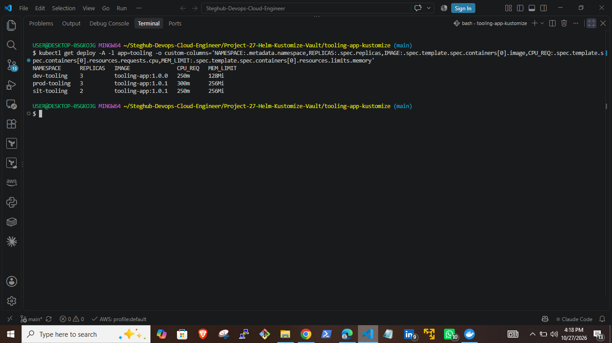

## Vault Design

**Installation.** The official Helm chart is driven through Kustomize's `helmCharts` field, so Vault follows the same base and overlay pattern as the app. A `local` overlay runs on kind with Shamir unseal; the `dev`, `sit` and `prod` overlays target EKS.

**High availability.** Three Vault servers share data through integrated Raft storage and find each other with `retry_join` through the headless `vault-internal` service. One pod is the leader and the others are followers.

**Auto-unseal.** On EKS, Vault decrypts its root key with AWS KMS on every start. The seal stanza sits inside `server.ha.raft.config`, which is what the chart reads in HA mode, and the key ARN is passed in from a generated Kubernetes Secret rather than written into the values file.

```hcl
seal "awskms" {
  region = "us-west-1"
}
```

**Secret injection.** Each environment's Deployment carries annotations that tell the injector which role to use, which secret to read, and how to render it. The container sources the rendered file before Apache starts, so the app reads ordinary environment variables:

```yaml
vault.hashicorp.com/agent-inject: "true"
vault.hashicorp.com/role: "tooling-sit"
vault.hashicorp.com/agent-inject-secret-database-cred.txt: "app/data/database/config/sit"
vault.hashicorp.com/agent-inject-template-database-cred.txt: |
  {{- with secret "app/data/database/config/sit" -}}
  export DB_HOST="{{ .Data.data.host }}"
  export DB_USER="{{ .Data.data.username }}"
  export DB_PASSWORD="{{ .Data.data.password }}"
  export DB_NAME="{{ .Data.data.dbname }}"
  {{- end -}}
```

**Configuration as code.** `vault/bootstrap.sh` configures Vault after `vault operator init` and is safe to re-run:

1. Enables the KV v2 engine at `app/` and the Kubernetes auth method.
2. Writes one policy and one role per environment from `vault/policies/`.
3. Enables `userpass` and creates a scoped `admin` login with the `vault-admin` policy.

After confirming the admin login works, the initial root token is revoked. A new root token can only be generated with a quorum of recovery keys, for emergencies.

## Security Model

**Vault access**

| Identity | Can | Cannot | Why |
|---|---|---|---|
| `tooling-sa` in `dev-tooling` | Read `app/data/database/config/dev` | Read sit or prod, write anything | Role `tooling-dev` is bound to that service account and namespace, and its policy names one exact path with `read` only |
| `tooling-sa` in `sit-tooling` | Read `.../config/sit` | Log in with the dev or prod role | Each role is bound to one namespace, so a valid token from another namespace is rejected |
| `tooling-sa` in `prod-tooling` | Read `.../config/prod` | Anything outside that path | Same pattern |
| Any other service account | Nothing | Log in to any tooling role | Roles accept only `tooling-sa` |
| `admin` (userpass) | Manage app secrets, tooling policies and Kubernetes roles | Read or change its own policy, enable auth methods, manage seal or root functions | Limits what a compromised admin login can do and prevents self-escalation |
| Initial root token | Nothing | Anything | Revoked after bootstrap |

An environment policy names one exact path:

```hcl
path "app/data/database/config/dev" {
  capabilities = ["read"]
}
```

Application tokens expire after one hour and are renewed automatically by the Vault Agent.

**AWS access**

Vault's KMS permission comes from this least-privilege policy, attached to the `vaultKMS` role:

```json
{
  "Version": "2012-10-17",
  "Statement": [
    {
      "Effect": "Allow",
      "Action": ["kms:Encrypt", "kms:Decrypt", "kms:DescribeKey"],
      "Resource": "arn:aws:kms:us-west-1:<ACCOUNT_ID>:key/<key-id>"
    }
  ]
}
```

* `Effect: Allow` opens only what is listed. Everything else is denied by default.
* `Action` is limited to what auto-unseal needs. Vault cannot create, delete, disable or re-key KMS keys, or change key policies.
* `Resource` is one key ARN, so no other key in the account can be used.

The role's trust policy accepts only the cluster's OIDC provider, and only for one service account:

```json
"Condition": {
  "StringEquals": {
    "oidc.eks.us-west-1.amazonaws.com/id/<cluster-id>:sub": "system:serviceaccount:vault:vault-kms",
    "oidc.eks.us-west-1.amazonaws.com/id/<cluster-id>:aud": "sts.amazonaws.com"
  }
}
```

The Vault service account is annotated with the role ARN, which completes the chain: Vault pod, runs as `vault-kms`, may assume `vaultKMS`, may encrypt and decrypt with one key. The app pods, cert-manager and everything else in the cluster have no KMS access, and nothing in the setup uses long-lived AWS access keys.

**Network**

Aurora sits in the private subnets, and its security group accepts port 3306 only from the EKS node security group. The ECR repository scans images on push.

**Terraform state**

The Aurora master password is stored in Terraform state, so the S3 state bucket is hardened: versioning enabled, all four public access blocks on, default encryption, a bucket policy that denies any request not made over HTTPS (`terraform/state-bucket/bucket-policy.json`), and a lifecycle rule that deletes non-current state versions after 30 days, so old versions containing past passwords do not accumulate.

## AWS Infrastructure

Project 24 provides the VPC and EKS cluster and exports `vpc_id`, `private_subnets` and `node_security_group_id`. Project 26 provides cert-manager with IRSA and the `letsencrypt-prod` ClusterIssuer. This project's Terraform reads Project 24's outputs through `terraform_remote_state` and adds:

| File | Creates |
|---|---|
| `kms.tf` | KMS key `dev-vault-kms` for auto-unseal |
| `iam.tf` | `VaultKMSUnseal` policy and the `vaultKMS` IRSA role bound to `vault:vault-kms` |
| `ecr.tf` | `tooling-app` repository with scan on push and `force_delete` |
| `aurora.tf` | Aurora MySQL Serverless v2 (min 0, max 1 ACU, pause after 300 seconds), subnet group, and a security group scoped to the EKS nodes |

One Aurora cluster holds three databases (`tooling_dev`, `tooling_sit`, `tooling_prod`), each with its own user. A Kubernetes Job initialises it: it waits for Aurora to resume from pause, creates the databases and users, and loads the schema only if the tables do not exist yet.

## Evidence

Screenshots are sanitised: account IDs, ARNs, endpoints and key identifiers are covered.

**Vault configured from code, with one policy and role per environment**

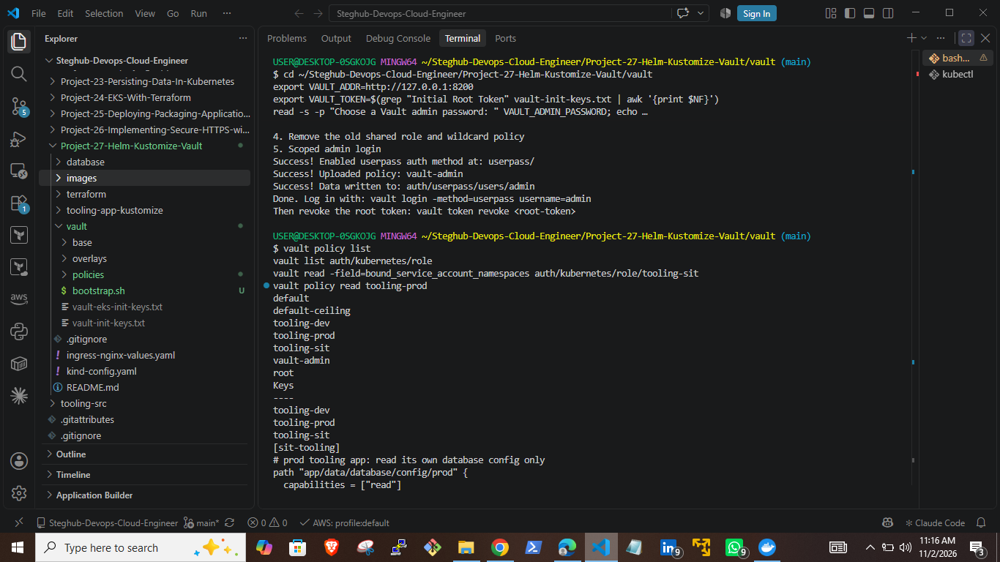

**Policy isolation: a dev token reads dev, and is denied sit, prod and writes**

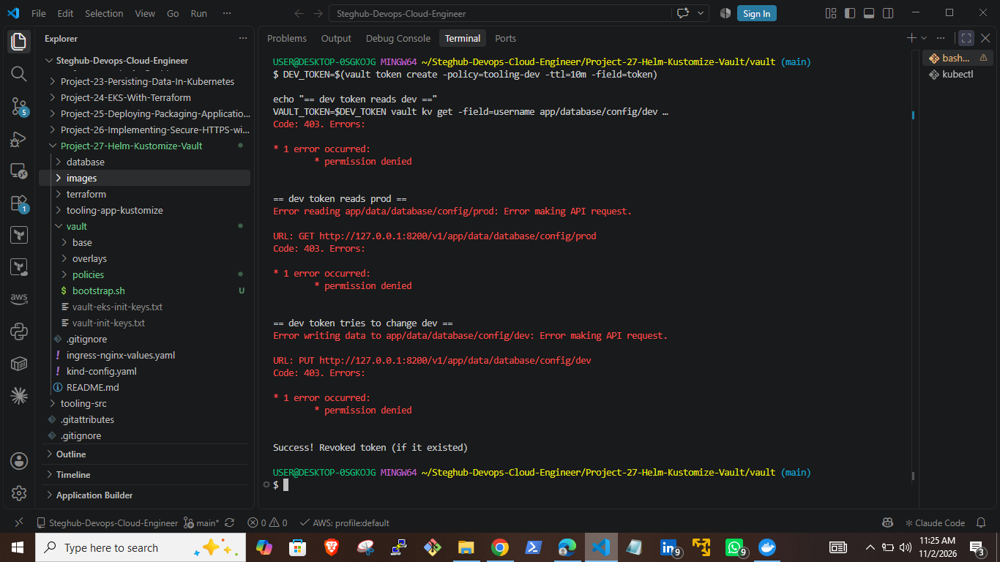

**All three environments on Vault: each pod 2/2, each with its own credentials, no Kubernetes Secrets, and a sit service account rejected by the dev role**

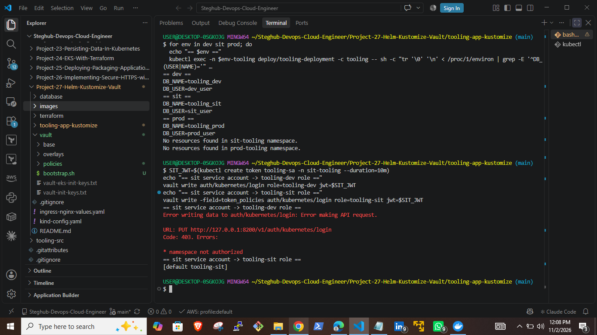

**Scoped admin: allowed to manage secrets, denied privilege escalation, root token revoked**

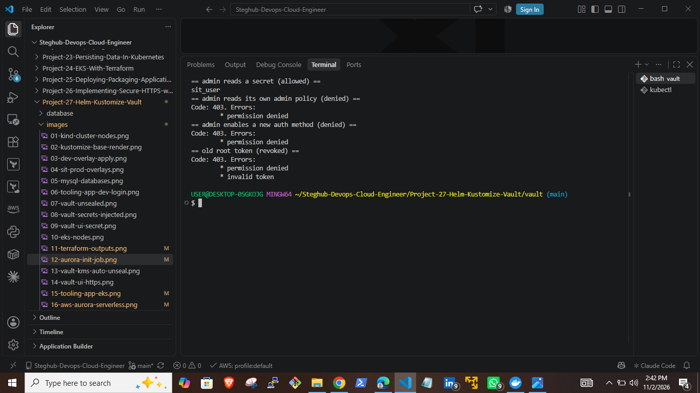

**Terraform outputs**

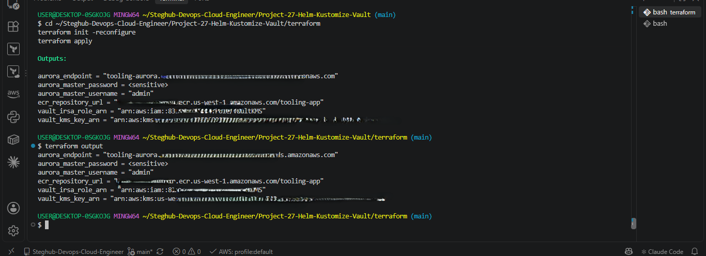

**Aurora Serverless v2 and its initialisation Job**

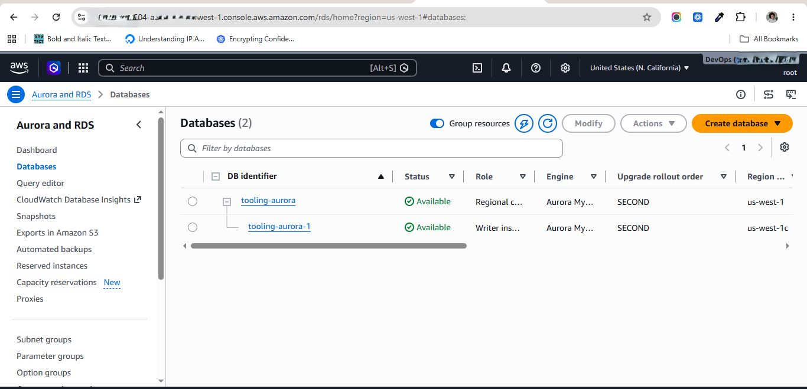

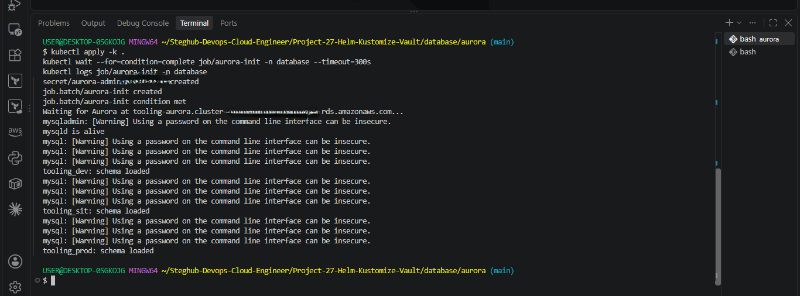

**KMS key and tooling image in ECR**

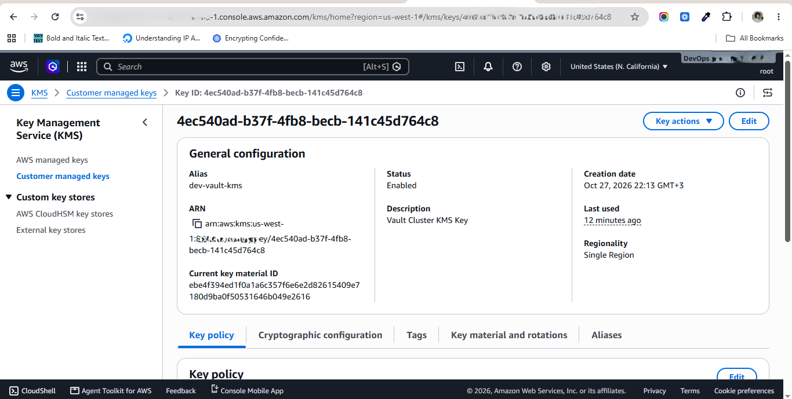

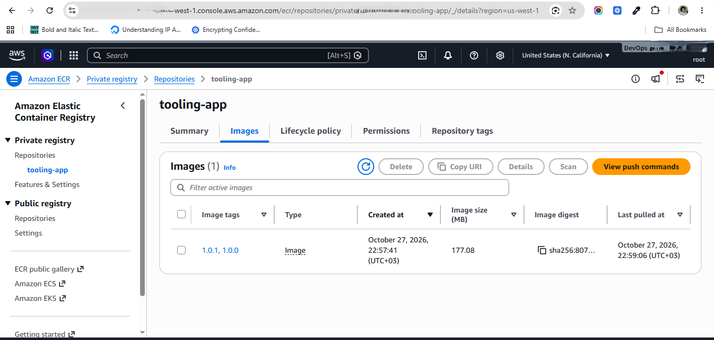

**KMS auto-unseal: a deleted Vault pod returns unsealed and rejoins the Raft cluster as a follower**

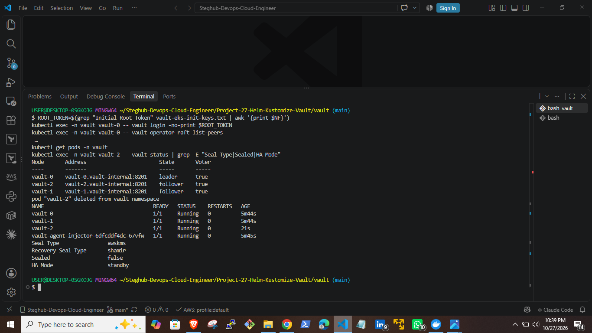

**Vault UI over HTTPS with a Let's Encrypt certificate**

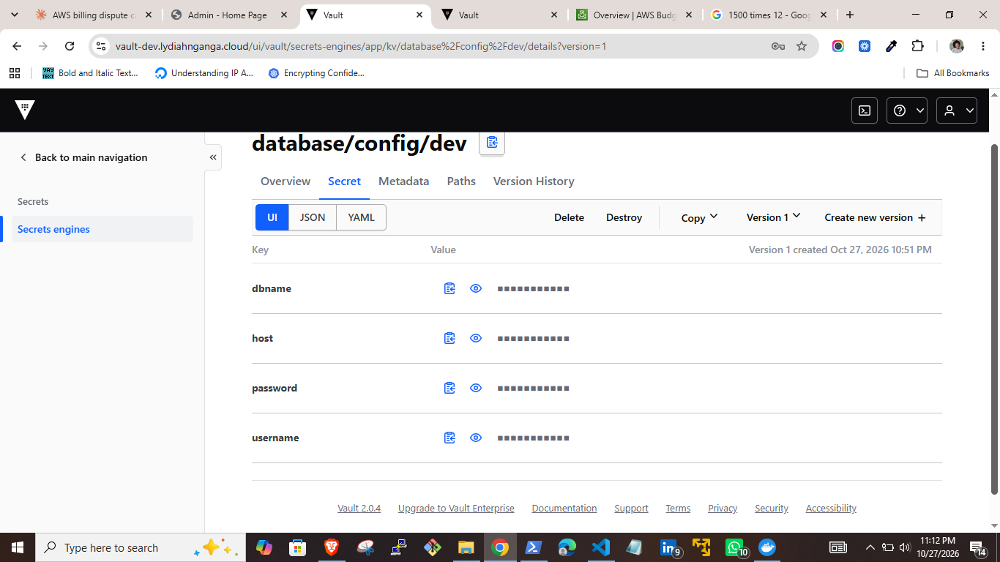

**Tooling app on EKS, connected to Aurora with credentials injected by Vault**

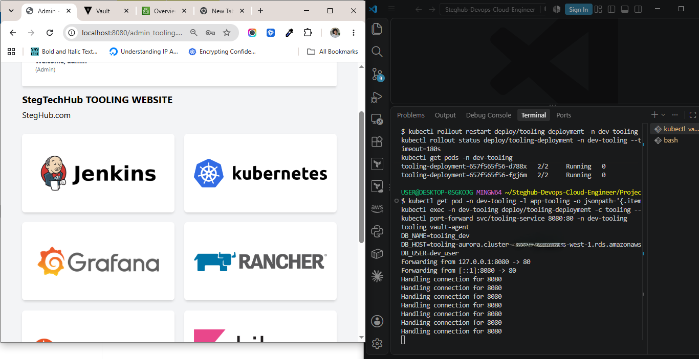

The EKS session ran the dev environment end to end. The per-environment policies, sit and prod injection, admin login and root token revocation were implemented afterwards and verified on the local kind cluster; the Terraform changes from that round (account ID placeholders, Aurora security group scoped to nodes) were validated with `terraform validate` and not re-applied.

## Running the Project

Prerequisites: an EKS cluster from Project 24, cert-manager from Project 26, ingress-nginx with `ingress-nginx-values.yaml`, and the AWS CLI configured for the target account.

1. `terraform apply` in `terraform/` to create KMS, IRSA, ECR and Aurora.
2. Push the tooling image to the ECR repository from the outputs.
3. Copy `database/aurora/aurora.env.example` to `aurora.env`, fill it from `terraform output`, and `kubectl apply -k database/aurora`.
4. Copy `vault/overlays/dev/.env.example` to `.env`, set the KMS key ARN, then `./deploy.sh vault dev`.
5. `vault operator init`, then run `vault/bootstrap.sh` with the root token, log in as `admin`, and revoke the root token.
6. Store each environment's credentials at `app/database/config/<env>`.
7. `./deploy.sh app dev` (and `sit`, `prod`).

Teardown order is described in [Cost and Teardown](#cost-and-teardown).

## Design Decisions

| Decision | Chosen | Over | Why |
|---|---|---|---|
| App configuration | Kustomize overlays | A Helm chart for the app | Our own simple manifests stay plain YAML with no template logic. Helm adds the most value for packaged community software |
| Vault installation | Helm chart driven by Kustomize `helmCharts` | Hand-written Vault manifests | Vault needs a StatefulSet, RBAC, a webhook, several Services and a PDB. The chart packages it, and Kustomize keeps per-environment values |
| Credentials delivery | Vault Agent Injector in every environment | Kubernetes Secrets | Credentials never exist as Kubernetes objects, access is controlled by Vault policy, and tokens are short-lived |
| Vault authorisation | One exact-path policy and role per environment | One shared role with a wildcard path | An environment can only read its own credentials |
| Vault administration | Scoped `userpass` admin and revoked root token | Keeping the root token | Least privilege for day-to-day work. Root is only regenerated from recovery keys in an emergency |
| Vault configuration | `bootstrap.sh` from version-controlled policy files | Manual CLI commands | Repeatable, reviewable and safe to re-run |
| Vault storage | Integrated Raft | Consul | No second cluster to operate, and HashiCorp's recommended setup |
| Unseal method on AWS | AWS KMS auto-unseal | Shamir keys | Pods unseal themselves after restarts with no person holding keys |
| Vault AWS access | IRSA scoped to one service account and one key | Node IAM role or access keys | Least privilege with no stored credentials |
| Account-specific values | Placeholder filled in by `deploy.sh` | Hardcoded account ID | Manifests are reusable across accounts and safe to publish |
| Image tag per environment | Kustomize `images` | A patch file per environment | One line per overlay, using the transformer built for this |
| Database | One Aurora Serverless v2 cluster, 3 databases | Three clusters or provisioned instances | Separate data and users per environment at a third of the cost, and scale to zero when idle |
| Aurora access | Node security group as source | Whole VPC CIDR | Only the cluster nodes can reach MySQL |
| Aurora admin password | `random_password` in hardened Terraform state | Secrets Manager managed password | Avoids another billable resource in a short-lived lab. State is protected instead (see [Security Model](#security-model)) |
| Container registry | Amazon ECR | Docker Hub | Same account and IAM as the cluster, scan on push, removed by `terraform destroy` |
| Local cluster | kind | minikube | Multi-node clusters from one config file, quick to recreate |
| Injector webhook port | 8443 | Adding a security group rule for 8080 | 8443 is already allowed by the EKS module's node rules, so no infrastructure change was needed |
| Load balancer | NLB | Classic ELB | Current load balancer type with static IPs per AZ |

## Challenges and How I Solved Them

**1. Vault Agent was not injected on EKS.** The manifests that produced 2/2 pods on kind produced 0/1 pods on EKS that crashed because `/vault/secrets/database-cred.txt` did not exist. The container logs showed the missing file, and the READY column showed the sidecar had never been added. The injector is a mutating webhook, so the EKS control plane must reach it across the node security group. The EKS module only allows the control plane in on 443, 4443, 6443, 8443, 9443 and 10250, while the injector listened on 8080, and the webhook's failure policy is `Ignore`, so pods were created silently without the sidecar. Setting `injector.port: 8443` fixed it.

**2. Terraform `Unauthorized` on the `aws-auth` ConfigMap.** A saved plan was applied, and the EKS token the Kubernetes provider uses is generated at plan time and only valid for 15 minutes. The cluster took longer than that to build. A fresh plan and immediate apply finished the last resource, and later applies planned and applied in one run.

**3. Three Vault replicas on two nodes.** The chart's default `required` anti-affinity would leave the third pod unschedulable, so the EKS overlays use `preferred` anti-affinity. See [limitations](#lab-limitations-and-production-changes) for what that costs in resilience.

**4. A valid unseal key was rejected.** Vault returned `'key' must be a valid hex or base64 string`. Git Bash on Windows rewrites arguments that start with `/` into Windows paths before passing them to native programs, and base64 keys can start with `/`. `MSYS_NO_PATHCONV=1` fixed it.

**5. `kind load docker-image` hung.** Docker Desktop adds provenance attestation manifests to builds and `kind load docker-image` stalls on them. Building with `--provenance=false --sbom=false` and loading with `kind load image-archive` solved it.

**6. Local resource limits.** Docker was limited to 2 GB of RAM, which caused API server timeouts and Vault pods stuck in `ContainerCreating`. The local cluster was reduced to two nodes, Docker raised to 3 GB, and local replicas scaled to one. A prod pod that stayed `Pending` with `Insufficient cpu` was the scheduler correctly enforcing resource requests.

**7. Port-forward pointed at a terminating pod.** `kubectl port-forward svc/...` picks one pod when it starts and does not load balance, so it attached to an old pod mid-rollout. Restarting it after the rollout resolved the connection error.

**8. Helm's test pod in rendered output.** `helm template`, which Kustomize uses, renders the chart's test Pod as a normal resource. `skipTests: true` removes it.

**9. Resources Terraform cannot see.** The NLB (from the ingress-nginx Service) and EBS volumes (from Vault's PVCs) are created by Kubernetes. They were deleted before the cluster and verified in AWS directly. A dangling Route 53 CNAME from an earlier project was also found and removed.

## Outdated Documentation Pitfalls

| Original approach | Issue | What I did |
|---|---|---|
| Prebuilt `tooling-app:1.0.2` image on Docker Hub | No longer exists | Built the image from my fork of the tooling repo and pushed it to ECR |
| `resources: - ../../bases` | Typo | `../../base` |
| `patchesStrategicMerge` | Deprecated | `patches` |
| `labels` without `includeSelectors` | Current Kustomize no longer adds these labels to selectors by default | `includeSelectors: true` |
| Vault chart 0.28.1 | Outdated | 0.34.1 (Vault 2.0.4), after checking default values had not changed shape |
| `seal "awskms"` under `server.standalone.config` | Ignored in HA mode, so auto-unseal would never be configured | Moved into `server.ha.raft.config` |
| Raft `autopilot` with `min_quorum = 5` | Does not fit a 3 node cluster | Left at defaults |
| `export db-username=...` in the Agent template | Hyphens are invalid in shell variable names | `DB_USER` and related names |
| `export db-host={{ .Data.data.password }}` | Sets the host to the password | `.Data.data.host` |
| `kubectl exec ... -- source /vault/secrets/...` | `source` is a shell built-in and would not affect the running app | Sourced in the container start command |
| One role with a wildcard secret path | Lets an environment read other environments' secrets | Exact-path policy and role per environment |

## Lab Limitations and Production Changes

| Lab choice | Limitation | Production change |
|---|---|---|
| 3 Vault pods on 2 nodes with soft anti-affinity | Losing the node with two Vault pods loses Raft quorum | At least 3 nodes in 3 availability zones, `required` anti-affinity and zone topology spread constraints |
| Vault UI on a public NLB | Login page reachable from the internet | Internal NLB reachable only from the VPC or VPN |
| Vault listener with `tls_disable = 1` | Traffic between Vault pods and from the ingress is plain HTTP inside the cluster | TLS on the Vault listener and Raft, with certificates from cert-manager |
| `userpass` admin login | A password-based human login | OIDC through an identity provider with MFA |
| Static database credentials in KV | One password per environment, rotated by hand | Vault database secrets engine issuing short-lived users per pod |
| Apache runs as root with reduced capabilities | Not a non-root container | Listen on a port above 1024 and run as `www-data` with `runAsNonRoot` |
| State bucket encrypted with SSE-S3 | Anyone with S3 read on the bucket can decrypt state | SSE-KMS with a key policy limited to the Terraform role |
| EKS 1.32 in extended support | $0.60/hr instead of $0.10/hr | Upgrade to a standard support version with Amazon Linux 2023 nodes |
| ingress-nginx | Retired by the Kubernetes project | Gateway API implementation |
| Single NAT gateway | Outbound internet from private subnets depends on one AZ | One NAT gateway per AZ |
| Vault Kubernetes auth role without `audience` | Vault 2.0 recommends audience validation | Set `audience` on each role |

## Cost and Teardown

Everything was built and debugged on kind first, so the EKS session lasted about two and a half hours and cost roughly $2 to $3, most of it the EKS extended support fee. A $10 budget alert was active throughout.

Teardown order: delete the app, Vault and its PVCs, and ingress-nginx so Kubernetes removes the EBS volumes and NLB; confirm in AWS; remove the DNS record; then `terraform destroy` this project, Project 26 and Project 24 in that order; finally sweep every region for instances, NAT gateways, Elastic IPs, volumes, load balancers and clusters. Only the Route 53 hosted zone was kept, and the KMS key completed its mandatory 7 day pending deletion.

## Key Takeaways

* A policy is only as narrow as its path. A wildcard that looked convenient let one environment read every other environment's credentials, and testing for denial, not just success, is what proves isolation.
* Vault Agent injection keeps credentials out of manifests and out of Kubernetes Secrets, with access controlled by Kubernetes identity and Vault policy.
* Auto-unseal is not optional in practice. Unsealing by hand after every local restart made the case for KMS better than any documentation.
* IRSA gives a single pod a single AWS permission with no stored keys, and the trust policy condition is what makes it specific.
* When something works locally but fails on EKS, check the network first. The missing sidecar came from a security group rule, not from Vault or Kubernetes configuration.
* Bootstrapping and administration belong in code and scoped identities, not in a root token and shell history.
* Building locally first saved money and time, and a deliberate teardown order is the only way to be sure nothing keeps billing.