# Secrets Management on Amazon EKS with HashiCorp Vault, AWS KMS Auto-Unseal and Aurora Serverless v2

**Multi-environment deployments with Kustomize and Helm, and zero hardcoded database credentials.**

This project deploys a PHP tooling application on Amazon EKS across three environments (dev, sit, prod) using Kustomize overlays, installs HashiCorp Vault in High Availability mode with the official Helm chart, and injects the application's database credentials from Vault at runtime so no credentials live in the manifests. 

Vault auto-unseals with AWS KMS through an IRSA role, the database runs on Aurora Serverless v2, the image is stored in Amazon ECR, and all AWS infrastructure is provisioned with Terraform.

## Table of Contents

1. [Project Overview](#project-overview)
2. [Architecture](#architecture)
3. [Tools and Versions](#tools-and-versions)
4. [Repository Structure](#repository-structure)
5. [Approach: Local First, AWS Last](#approach-local-first-aws-last)
6. [Phase 1: Local Build on kind](#phase-1-local-build-on-kind)
7. [Phase 2: Preparing the AWS Infrastructure Code](#phase-2-preparing-the-aws-infrastructure-code)
8. [Phase 3: Running on Amazon EKS](#phase-3-running-on-amazon-eks)
9. [Teardown](#teardown)
10. [Design Decisions](#design-decisions)
11. [Challenges and How I Solved Them](#challenges-and-how-i-solved-them)
12. [Outdated Documentation Pitfalls](#outdated-documentation-pitfalls)
13. [Cost](#cost)
14. [What I Would Improve Next](#what-i-would-improve-next)
15. [Key Takeaways](#key-takeaways)

## Project Overview

**Goals**

* Use **Kustomize** to keep one base configuration for the tooling app and tailor it per environment (replicas, resource requests and limits, image tag, credentials).
* Use **Helm**, driven through Kustomize, to install a complex third-party application (Vault) without writing its manifests by hand.
* Run **Vault in HA mode** with integrated Raft storage.
* Store the database credentials in Vault and **inject them into the app** using the Vault Agent Injector and Kubernetes authentication.
* Provision **Aurora, KMS, IAM (IRSA) and ECR with Terraform**, reusing the EKS cluster code from earlier projects.

**Outcome**

* Three Kustomize environments rendering different replicas, resources and image tags from one base.
* A 3 node Vault Raft cluster on EKS that unseals itself through AWS KMS, including after a pod is deleted.
* The tooling app logging in against Aurora with credentials it only ever receives from Vault.
* Everything torn down afterwards, with a full region sweep confirming nothing was left running.

## Architecture

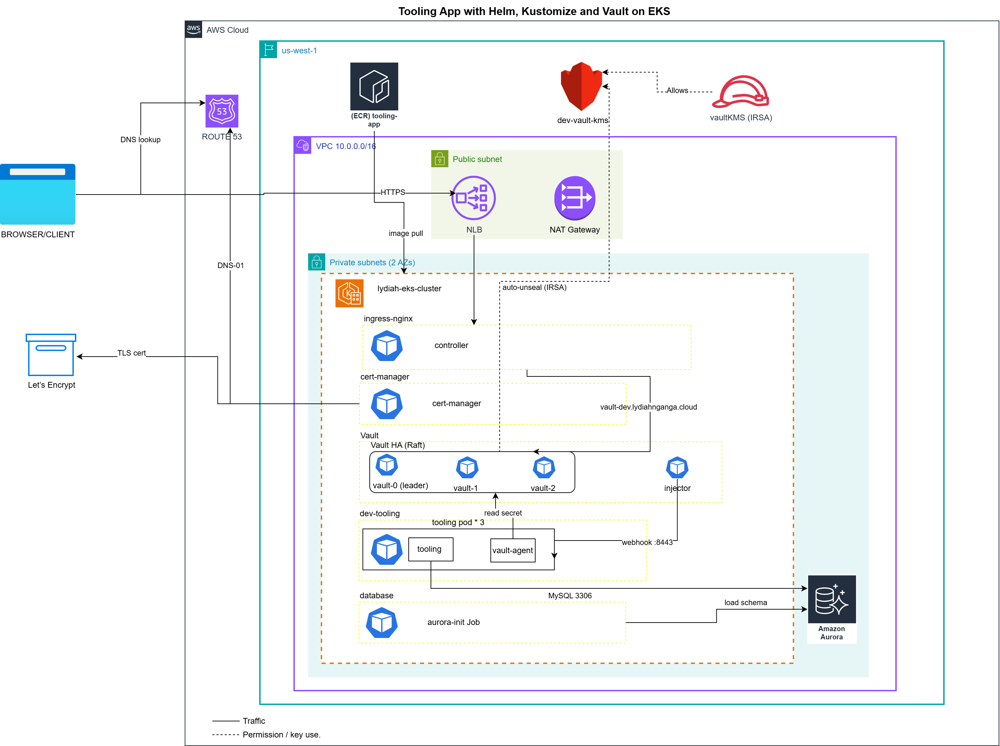

**How traffic and permissions flow**

1. The browser resolves `vault-dev.lydiahnganga.cloud` through Route 53 and connects over HTTPS to the Network Load Balancer.
2. The NLB forwards to the ingress-nginx controller, which routes to the Vault HA (Raft) cluster.
3. cert-manager proves domain ownership to Let's Encrypt with a Route 53 DNS-01 challenge and keeps the TLS certificate renewed.
4. Vault auto-unseals with the `dev-vault-kms` key. The `vaultKMS` IAM role (IRSA) is what allows the Vault pods to use that key.
5. When a tooling pod is created, the Vault Agent Injector webhook (port 8443) adds a `vault-agent` sidecar.
6. The sidecar logs in to Vault with the pod's Kubernetes service account and reads the database credentials.
7. The tooling container uses those credentials to connect to Aurora on port 3306.
8. The aurora-init Job creates the three databases and loads the schema.
9. EKS nodes pull the tooling image from Amazon ECR.

The editable source is embedded in the PNG, so it can be opened and updated directly in draw.io.

## Tools and Versions

| Tool | Version used | Notes |
|---|---|---|
| kind | 0.33.0 | Local cluster, Kubernetes 1.37 |
| kubectl (with built-in Kustomize) | 1.36.1 / Kustomize 5.8.1 | `kubectl kustomize --enable-helm` renders Helm charts |
| Helm | 4.3.1 | Most guides assume Helm 3; no changes were needed |
| Vault Helm chart | 0.34.1 (Vault 2.0.4) | Older guides pin 0.28.1 |
| Vault Agent Injector | 1.7.6 | |
| MySQL (local) | 8.4 LTS | Stand-in for Aurora on kind |
| Aurora MySQL | 8.0.mysql_aurora.3.10.6 | Serverless v2, scale to zero |
| Terraform | 1.14.7 | AWS provider 5.100 |
| Amazon EKS | 1.32 | Reused from Project 24 (see decisions) |
| cert-manager | via Project 26 Terraform | ClusterIssuer `letsencrypt-prod` |
| ingress-nginx | latest chart | Exposed through an NLB |

## Repository Structure

```
Project-27-Helm-Kustomize-Vault/
├── kind-config.yaml
├── ingress-nginx-values.yaml
├── tooling-app-kustomize/
│   ├── base/                     # deployment, service, kustomization
│   └── overlays/
│       ├── dev/                  # 3 replicas, Vault annotations, tooling-sa
│       ├── sit/                  # 2 replicas, larger resources, tag 1.0.1
│       └── prod/                 # 3 replicas, largest resources, tag 1.0.1
├── database/
│   ├── (local MySQL)             # deployment, pvc, service, init-db.sh, tooling-db.sql
│   └── aurora/                   # Kubernetes Job that initialises Aurora
├── vault/
│   ├── base/                     # vault namespace
│   └── overlays/
│       ├── local/                # kind: Shamir unseal, 1 replica, no ingress
│       ├── dev/                  # EKS: KMS seal, ingress + TLS, IRSA
│       ├── sit/
│       └── prod/
└── terraform/                    # KMS, IRSA, ECR, Aurora
```

Secrets are never committed. `.env`, `db.env`, `aurora.env`, the Vault init key files, downloaded Helm `charts/` and `.terraform/` are all in `.gitignore`.

## Approach: Local First, AWS Last

EKS with its supporting resources costs roughly $1 an hour. To keep the bill small, I split the project into three phases:

1. **Local (free):** build and test every Kubernetes piece on a kind cluster, including Vault, Kubernetes auth and secret injection.
2. **Prepare (free):** write and validate the Terraform and the EKS specific overlays without applying anything.
3. **Run on AWS (paid):** apply, swap the database host and unseal method, verify and destroy in one sitting.

By the time I touched AWS, the remaining work was mostly applying tested code, so the EKS session took about two and a half hours.

## Phase 1: Local Build on kind

### 1. Local cluster

A kind cluster with a control plane and one worker node. I originally planned four nodes so Vault's three replicas could each sit on their own node, but my laptop could not support it (see [Challenges](#challenges-and-how-i-solved-them)).

```yaml
kind: Cluster
apiVersion: kind.x-k8s.io/v1alpha4
name: tooling-local
nodes:
  - role: control-plane
  - role: worker
```


### 2. Kustomize base and dev overlay

The base holds a standard Deployment and Service. The dev overlay creates its own namespace, adds an `env` label, and patches replicas from 1 to 3.

```yaml
# overlays/dev/kustomization.yaml (first version)
apiVersion: kustomize.config.k8s.io/v1beta1
kind: Kustomization
namespace: dev-tooling
labels:
  - pairs:
      env: dev-tooling
    includeSelectors: true
resources:
  - ../../base
  - namespace.yaml
patches:
  - path: deployment.yaml
```

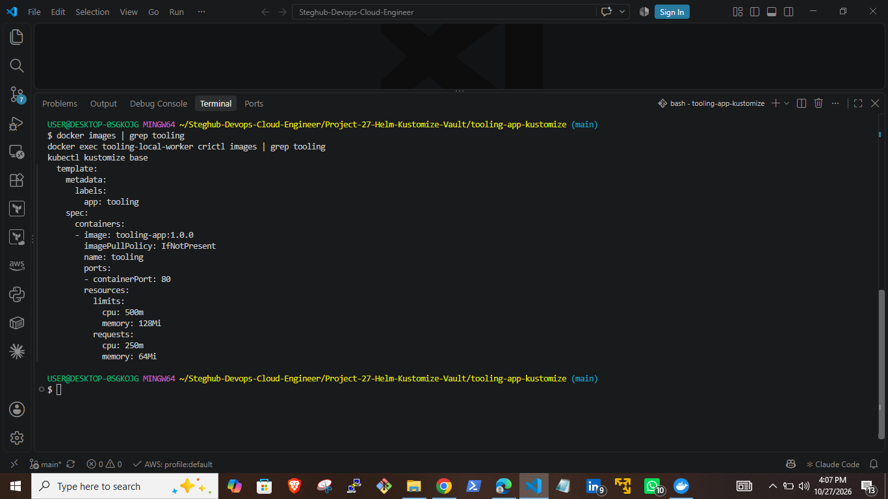

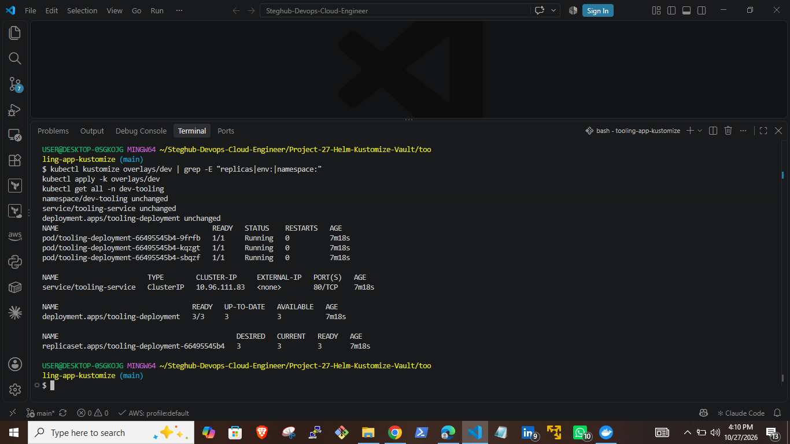

### 3. Side task: SIT and PROD overlays

Each environment gets different replicas, resources and image tag from the same base.

| | dev | sit | prod |
|---|---|---|---|
| Replicas | 3 | 2 | 3 |
| Requests | 64Mi / 250m | 128Mi / 250m | 128Mi / 300m |
| Limits | 128Mi / 500m | 256Mi / 500m | 256Mi / 600m |
| Image tag | 1.0.0 | 1.0.1 | 1.0.1 |

The tag change uses Kustomize's `images` field rather than another patch file:

```yaml
images:
  - name: tooling-app
    newName: 835960997504.dkr.ecr.us-west-1.amazonaws.com/tooling-app
    newTag: "1.0.1"
```

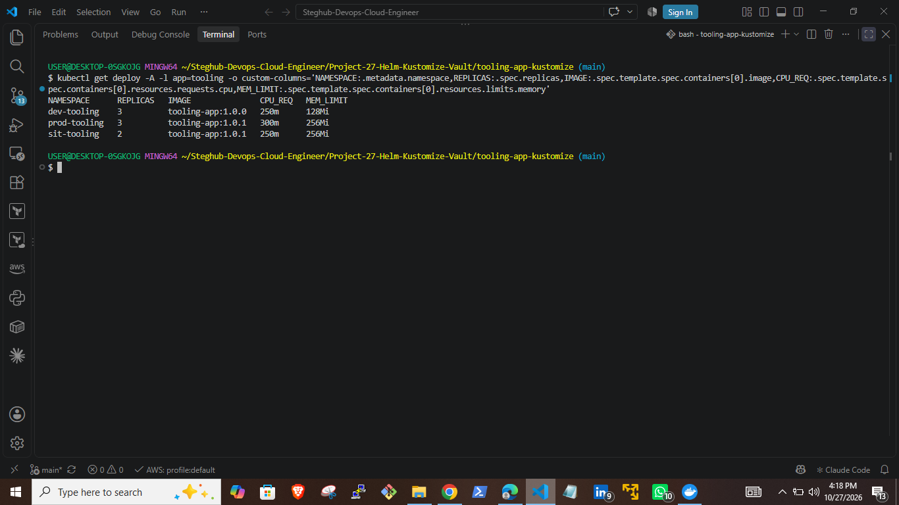

One prod pod stayed `Pending` with `Insufficient cpu`. That was the scheduler correctly refusing to place a pod whose CPU request could not be guaranteed on my laptop, not a configuration error.

### 4. Database with per-environment Secrets

Locally, one MySQL instance stands in for Aurora with three databases (`tooling_dev`, `tooling_sit`, `tooling_prod`) and a separate user per environment. An init script mounted from a ConfigMap creates them and loads `tooling-db.sql` into each.

Each overlay generates its own `tooling-db-credentials` Secret from a gitignored `db.env` file using `secretGenerator`, and the base Deployment reads `DB_HOST`, `DB_USER`, `DB_PASSWORD` and `DB_NAME` from it. Kustomize appends a content hash to the Secret name and rewrites every reference, so changing a password automatically triggers a new rollout.

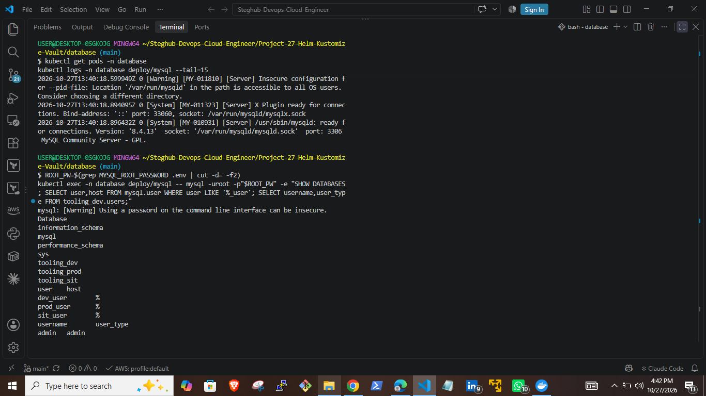

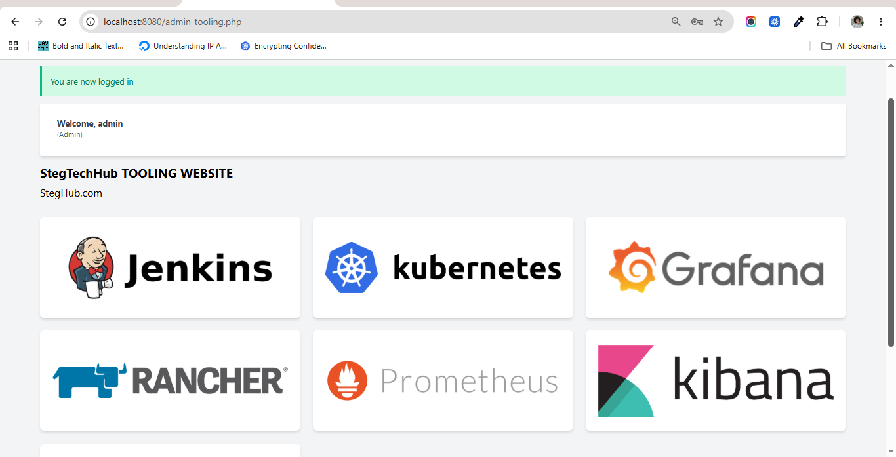

### 5. Vault HA with Raft, installed through Helm and Kustomize

Vault follows the same pattern as the app, with a `base` (namespace) and overlays. I added a `local` overlay for kind so the `dev`, `sit` and `prod` overlays could stay exactly as intended for EKS.

```yaml
# vault/overlays/local/kustomization.yaml
apiVersion: kustomize.config.k8s.io/v1beta1
kind: Kustomization
namespace: vault
resources:
  - ../../base
patches:
  - path: namespace.yaml
helmCharts:
  - name: vault
    repo: https://helm.releases.hashicorp.com
    version: 0.34.1
    releaseName: vault
    namespace: vault
    valuesFile: values.yaml
    skipTests: true
```

The Raft configuration uses `retry_join` so every pod can find the others through the headless `vault-internal` service:

```hcl
storage "raft" {
  path = "/vault/data"
  retry_join { leader_api_addr = "http://vault-0.vault-internal:8200" }
  retry_join { leader_api_addr = "http://vault-1.vault-internal:8200" }
  retry_join { leader_api_addr = "http://vault-2.vault-internal:8200" }
}
service_registration "kubernetes" {}
```

`kubectl apply -k` cannot render Helm charts, so the chart is rendered and piped:

```bash
kubectl kustomize --enable-helm overlays/local | kubectl apply -f -
```

### 6. Initialise and unseal (Shamir)

Locally there is no KMS, so Vault uses Shamir's secret sharing: the root key is split into 3 shares and any 2 unseal it.

```bash
kubectl exec -n vault vault-0 -- vault operator init -key-shares=3 -key-threshold=2 > vault-init-keys.txt
kubectl exec -n vault vault-0 -- vault operator unseal <key-1>
kubectl exec -n vault vault-0 -- vault operator unseal <key-2>
```

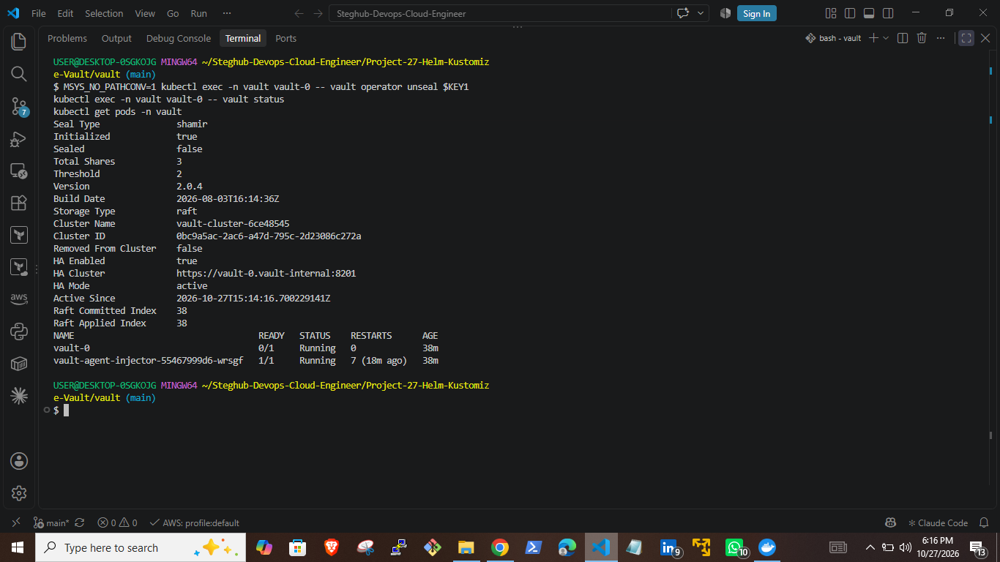

### 7. KV secret, Kubernetes auth, policy and role

```bash
vault secrets enable -path=app kv-v2
vault kv put app/database/config/dev username=dev_user password=<from .env> \
  host=mysql.database.svc.cluster.local dbname=tooling_dev

vault auth enable kubernetes
vault write auth/kubernetes/config kubernetes_host="https://kubernetes.default.svc:443"

vault policy write tooling-db - <<'EOF'
path "app/data/database/config/*" {
  capabilities = ["read"]
}
EOF

vault write auth/kubernetes/role/tooling-role \
  bound_service_account_names=tooling-sa \
  bound_service_account_namespaces=dev-tooling \
  policies=tooling-db ttl=6h
```

The role means only pods running as `tooling-sa` in `dev-tooling` can log in, and they can only read the dev database path.

### 8. Injecting the credentials with Vault Agent

The dev overlay adds a `tooling-sa` ServiceAccount and these annotations. The injector then adds an init container and a `vault-agent` sidecar that log in to Vault and write the credentials to `/vault/secrets/database-cred.txt`.

```yaml
vault.hashicorp.com/agent-inject: "true"
vault.hashicorp.com/role: "tooling-role"
vault.hashicorp.com/agent-inject-secret-database-cred.txt: "app/data/database/config/dev"
vault.hashicorp.com/agent-inject-template-database-cred.txt: |
  {{- with secret "app/data/database/config/dev" -}}
  export DB_HOST="{{ .Data.data.host }}"
  export DB_USER="{{ .Data.data.username }}"
  export DB_PASSWORD="{{ .Data.data.password }}"
  export DB_NAME="{{ .Data.data.dbname }}"
  {{- end -}}
```

Rather than reading the file by hand, the app ingests it automatically. The container sources the file before starting Apache, so the variables are in the web server's environment:

```yaml
command: ["/bin/sh", "-c", ". /vault/secrets/database-cred.txt && exec start-apache"]
```

I also removed the base's Secret references for dev with a JSON patch, so in dev **Vault is the only source of credentials**:

```yaml
- target:
    kind: Deployment
    name: tooling-deployment
  patch: |-
    - op: remove
      path: /spec/template/spec/containers/0/env
```

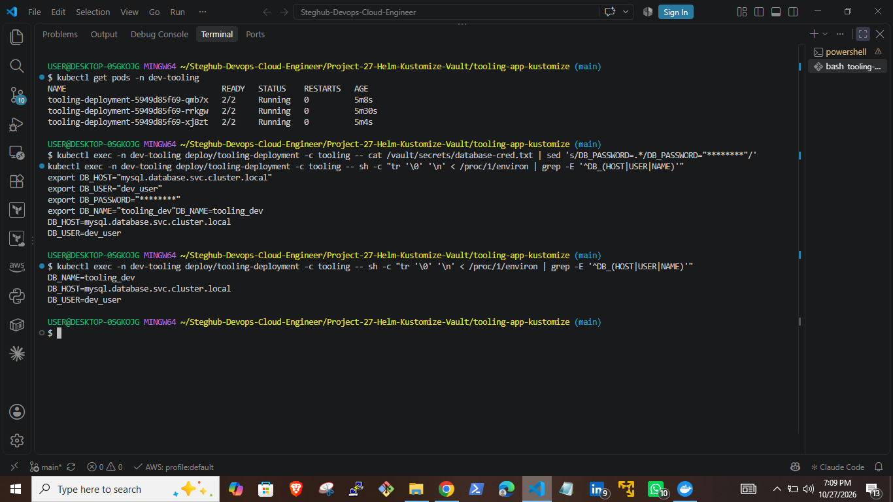

### 9. Vault UI

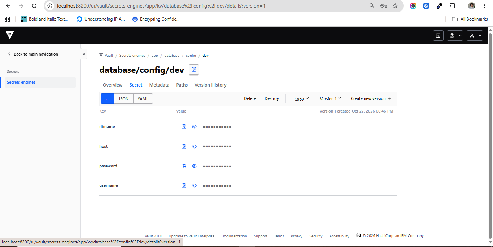

## Phase 2: Preparing the AWS Infrastructure Code

**Reusing earlier projects.** Project 24 builds the VPC and EKS cluster. I added `vpc_id`, `private_subnets` and `vpc_cidr_block` outputs so this project can place Aurora in the same network. Project 26 already installs cert-manager with IRSA and a `letsencrypt-prod` ClusterIssuer using Route 53 DNS-01, which is exactly what the Vault ingress needs, so it was reused unchanged.

**This project's Terraform** reads Project 24's outputs through `terraform_remote_state` and creates:

| File | Creates |
|---|---|
| `kms.tf` | KMS key `dev-vault-kms` for Vault auto-unseal |
| `iam.tf` | `VaultKMSUnseal` policy (Encrypt, Decrypt, DescribeKey on that key only) and the `vaultKMS` IRSA role bound to `vault:vault-kms` |
| `ecr.tf` | `tooling-app` repository with scan on push and `force_delete` |
| `aurora.tf` | Aurora MySQL Serverless v2 cluster (min 0, max 1 ACU, pause after 300s), subnet group, and a security group allowing 3306 only from the VPC |

**Aurora initialisation Job.** A Kubernetes Job replaces the local init script on EKS. It waits for Aurora to respond (Serverless v2 may be paused), creates the three databases and users, and only loads the schema if the `users` table does not already exist, so it is safe to re-run.

**Vault EKS overlays.** `dev`, `sit` and `prod` each have a `.env`, `kustomization.yaml` (with a `vault-kms` secretGenerator), `namespace.yaml` and `values.yaml`. Key settings:

```yaml
injector:
  port: 8443            # see Challenges: EKS node security group
server:
  affinity: |           # soft anti-affinity: 3 pods on a 2 node cluster
    podAntiAffinity:
      preferredDuringSchedulingIgnoredDuringExecution: ...
  ingress:
    enabled: true
    ingressClassName: nginx
    annotations:
      cert-manager.io/cluster-issuer: letsencrypt-prod
  extraSecretEnvironmentVars:
    - envName: VAULT_AWSKMS_SEAL_KEY_ID
      secretName: vault-kms
      secretKey: VAULT_AWSKMS_SEAL_KEY_ID
  ha:
    raft:
      config: |
        ...
        seal "awskms" {
          region = "us-west-1"
        }
  serviceAccount:
    name: vault-kms
    annotations:
      eks.amazonaws.com/role-arn: arn:aws:iam::835960997504:role/vaultKMS
```

Everything was validated with `terraform validate` and render-tested with `kubectl kustomize` before any AWS resource existed.

## Phase 3: Running on Amazon EKS

1. Set a $10 AWS Budget alert for the session.
2. Applied Project 24 (EKS, 59 resources).

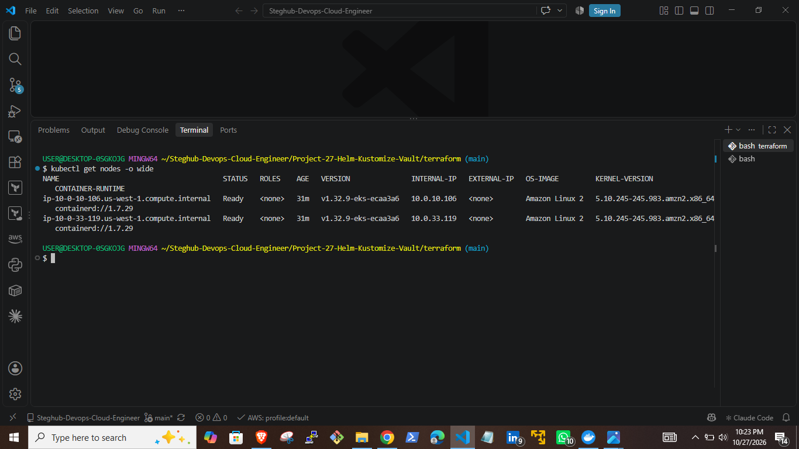

3. Applied Project 26 (cert-manager and ClusterIssuer).
4. Installed ingress-nginx with an NLB.
5. Applied this project's Terraform.

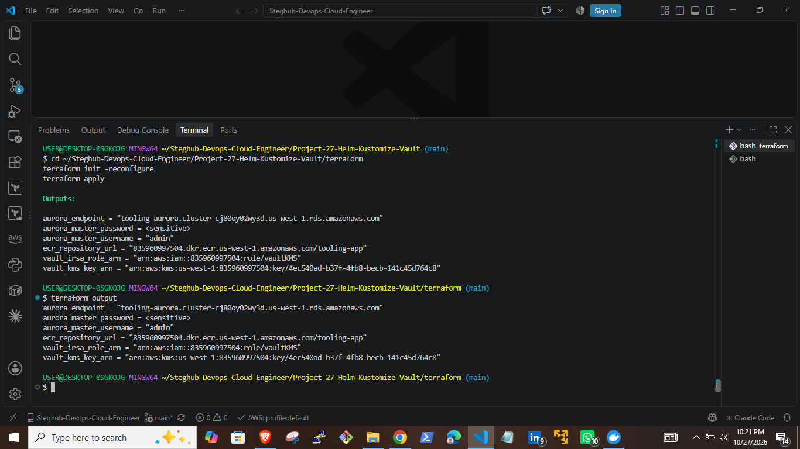

The resources created by this project's Terraform, as seen in the AWS console:

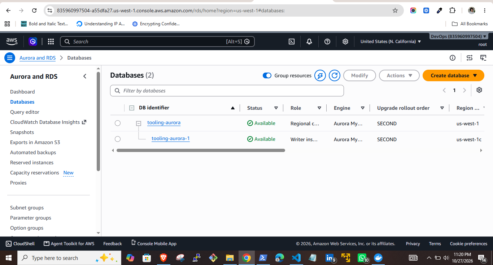

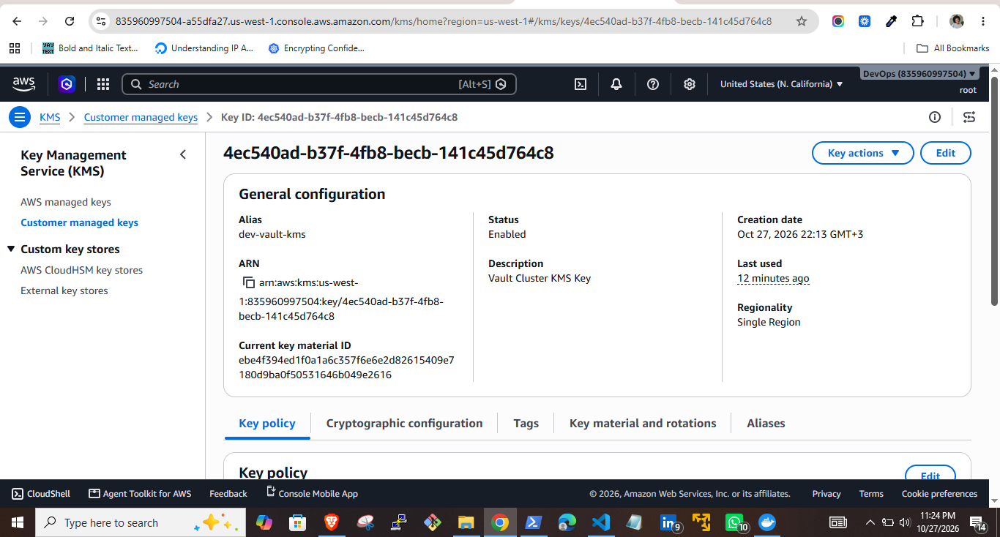

6. Pushed the tooling image to ECR, where it was scanned on push.

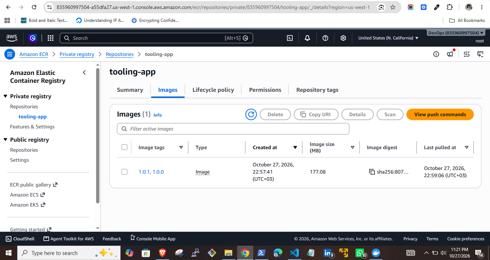
7. Filled `aurora.env` from Terraform outputs and ran the Aurora init Job.

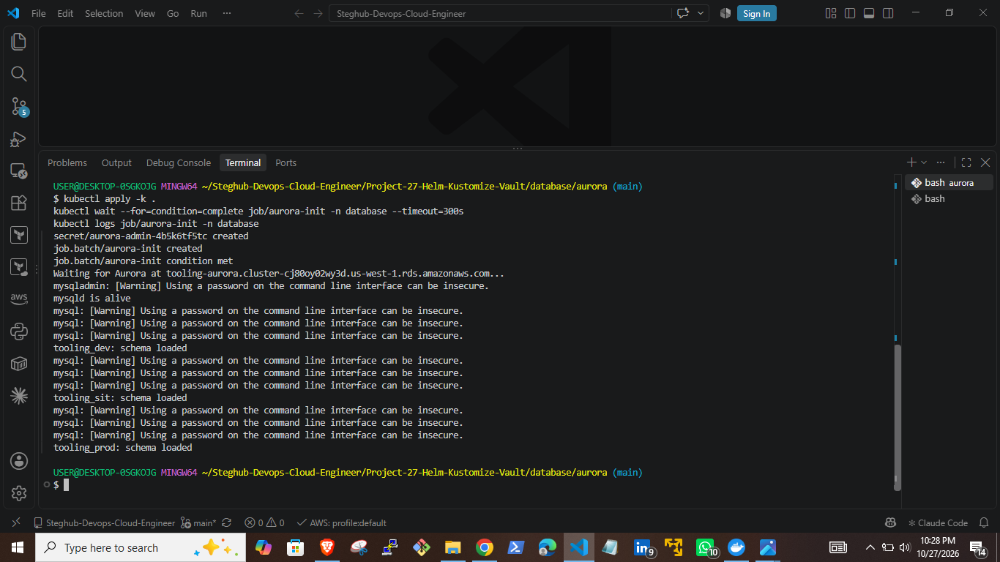

8. Deployed Vault dev and ran `vault operator init`. With the KMS seal, Vault returns **recovery keys** instead of unseal keys and unseals itself. To prove it, I deleted `vault-2`: it came back, unsealed on its own and rejoined the Raft cluster as a follower.

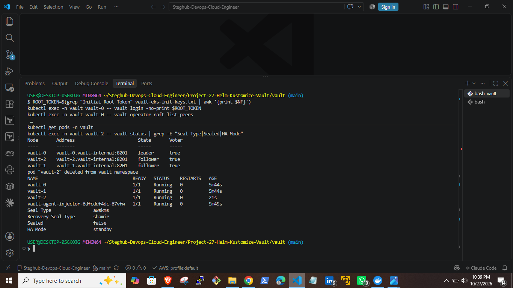

9. Pointed `vault-dev.lydiahnganga.cloud` at the NLB. cert-manager issued a Let's Encrypt certificate and I configured Vault from my laptop with the Vault CLI over HTTPS, storing the Aurora endpoint as the dev host.

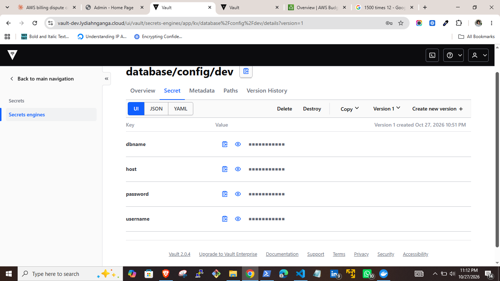

10. Deployed the tooling app. Each pod ran 2/2 (app plus vault-agent), the app process held `DB_HOST` pointing at Aurora, and the admin login worked.

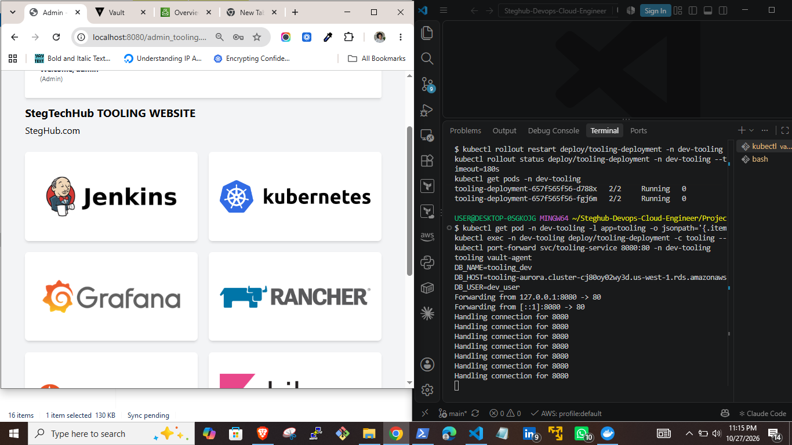

## Teardown

Order matters, because some AWS resources are created by Kubernetes, not Terraform, and Terraform does not know about them:

1. Deleted the app, the Aurora Job and Vault, then the Vault PVCs (StatefulSet volumes are not removed automatically), so the EBS CSI driver deleted the EBS volumes.
2. Uninstalled ingress-nginx so the NLB was deleted.
3. Confirmed no PVs, load balancers or tagged EBS volumes remained.
4. Removed the `vault-dev` DNS record.
5. `terraform destroy` in reverse order: this project, then Project 26, then Project 24.
6. Ran an all-regions sweep for instances, NAT gateways, Elastic IPs, volumes, load balancers and EKS clusters, which came back empty.

The only things left are the Route 53 hosted zone (kept on purpose) and the KMS key in its mandatory 7 day pending deletion period.

## Design Decisions

| Decision | Chosen | Over | Why |
|---|---|---|---|
| Local cluster | kind | minikube | Runs nodes as Docker containers, supports multi-node clusters from one config file, and is quick to delete and recreate |
| App configuration | Kustomize overlays | A Helm chart for the app | The app is our own simple manifests. Overlays keep plain YAML with no template logic, and Helm adds the most value for packaged community software |
| Vault installation | Helm chart driven by Kustomize `helmCharts` | Hand-written Vault manifests | Vault needs a StatefulSet, RBAC, a webhook, several services and a PDB. The official chart packages all of it, and Kustomize still lets each environment keep its own values |
| Image tag per environment | Kustomize `images` field | A patch file per environment | One line per overlay, and it is the purpose-built transformer for image names and tags |
| Credentials before Vault | `secretGenerator` from gitignored env files | Hand-written Secret YAML | Keeps values out of Git, and the hash suffix triggers a rollout when a value changes |
| Local database | MySQL pod with 3 databases | Aurora during development | Free, and swapping to Aurora later only changes the host |
| AWS database | One Aurora cluster, 3 databases | Three Aurora clusters | Same separation per environment at a third of the cost |
| Aurora capacity | Serverless v2 with scale to zero | A provisioned instance | Pauses when idle, so a learning environment costs close to nothing between tests |
| Aurora admin password | `random_password` in Terraform state | Secrets Manager managed password | Avoids another billable resource that can be left behind after teardown |
| Vault storage | Integrated Raft | Consul | No second cluster to run, and it is HashiCorp's recommended production setup |
| Unseal method on AWS | AWS KMS auto-unseal | Shamir keys | Pods unseal themselves after restarts, with no human holding keys. Locally I saw exactly why this matters when every restart sealed Vault again |
| Vault AWS access | IRSA role scoped to one service account and one key | Node IAM role or access keys | Least privilege, and no credentials in values files |
| Delivering secrets to the app | Vault Agent Injector | Kubernetes Secrets | Credentials never exist as a Kubernetes object, access is controlled by Vault policy, and tokens are short-lived |
| Loading the injected file | Sourcing it in the container command | Running `source` manually through `kubectl exec` | Automatic on every pod start, with no manual step |
| Container registry | Amazon ECR | Docker Hub | Same account and IAM as the cluster, scan on push, removed by `terraform destroy`, and the previously published image is no longer available |
| Image naming | ECR name used locally and on EKS | Separate local and EKS overlays | One set of manifests. Locally the image is tagged with the ECR name and loaded into kind |
| Vault HA on 2 nodes | Soft (preferred) anti-affinity | A third node | Spreads pods when possible without paying for an extra t3.large. A production cluster should keep the hard rule with 3 or more nodes |
| Injector webhook port | Move the injector to 8443 | Adding a security group rule for 8080 | 8443 is already allowed by the EKS module's recommended node rules, so the fix is one value with no infrastructure change |
| Infrastructure reuse | `terraform_remote_state` from Project 24 | Hardcoding VPC and OIDC values | Values stay correct every time the cluster is rebuilt |
| Load balancer | NLB | Classic ELB (the default) | Current AWS load balancer type with lower latency and static IPs per AZ |
| Ingress controller | ingress-nginx | Gateway API implementation | Already used in Projects 25 and 26. The project has since been retired by Kubernetes, so the Gateway API is the path for future projects |
| EKS version | Keep 1.32 | Upgrade to 1.35 | 1.32 is in extended support ($0.60/hr instead of $0.10/hr), but upgrading means moving from module v19 and Amazon Linux 2 nodes to v20 and AL2023. For one short session the extra cost was about $2.50, so I kept the upgrade as a separate task |
| Local Vault replicas | 1 | 3 | My laptop could not run three Vault pods plus MySQL. The Raft configuration is identical, and HA was shown on EKS |

## Challenges and How I Solved Them

**1. `kind load docker-image` hung indefinitely.** Docker Desktop now adds provenance attestation manifests to builds, and `kind load docker-image` stalls on them. I rebuilt with `--provenance=false --sbom=false`, saved the image with `docker save --platform linux/amd64` and used `kind load image-archive` instead.

**2. The laptop ran out of resources.** My WSL configuration limited Docker to 2 GB of RAM. With four kind nodes, the API server returned `TLS handshake timeout`, a watch stream dropped, and Vault pods sat in `ContainerCreating` for over 10 minutes. I reduced the cluster to two nodes, raised the WSL limit to 3 GB (the laptop has 8 GB, so giving more would have starved Windows), scaled the app to one replica while working on Vault, and ran a single Vault replica locally.

**3. A prod pod stuck in `Pending`.** `kubectl describe` showed `Insufficient cpu`. Dev, sit and prod together requested more CPU than the worker had. This was Kubernetes enforcing requests correctly, not a configuration error. I confirmed all three overlays rendered correctly, then removed sit and prod to free capacity for the next steps.

**4. The app showed a database connection error right after a rollout.** `kubectl port-forward svc/...` does not load balance. It picks one pod when it starts, and it had picked the last old pod from before the credentials were added. Once that pod terminated and I restarted the port-forward, the login worked.

**5. Helm's test pod appeared in the rendered output.** `helm template`, which Kustomize uses, outputs the chart's test Pod as a normal resource, so it would run on every apply. Kustomize's `skipTests: true` removes it.

**6. A valid unseal key was rejected.** Vault returned `'key' must be a valid hex or base64 string`. Git Bash on Windows rewrites any argument starting with `/` into a Windows path before passing it to `kubectl.exe`, and base64 keys can start with `/`. The same thing later turned `/vault/secrets/...` into `C:/Program Files/Git/vault/secrets/...`. Setting `MSYS_NO_PATHCONV=1` (now permanent in my `.bashrc`) fixed both.

**7. Unseal progress did not move.** Vault ignores a key share it has already received in the current attempt. My first key had failed because of the path issue above, so resubmitting the second key did nothing. Submitting a different share completed the unseal.

**8. Terraform `Unauthorized` on the `aws-auth` ConfigMap.** I applied a saved plan. The Kubernetes provider's EKS token is generated at plan time and is only valid for 15 minutes, and the cluster took longer than that to build. Everything else had been created, so a fresh plan and immediate apply finished the last resource. For later applies I let `terraform apply` plan and apply in one run.

**9. Vault Agent was not injected on EKS.** The same manifests that produced 2/2 pods on kind produced 0/1 pods on EKS that crashed because `/vault/secrets/database-cred.txt` did not exist. The injector is a mutating webhook, so the EKS control plane must reach the injector pod. The node security group from the EKS module only allows the control plane in on 443, 4443, 6443, 8443, 9443 and 10250, while the injector listens on 8080. The webhook's failure policy is `Ignore`, so pods were created silently without the sidecar. Setting `injector.port: 8443` fixed it with no infrastructure change.

**10. Three Vault replicas on a two node cluster.** The chart's default anti-affinity is `required`, so the third pod would never schedule. I switched the EKS overlays to `preferred` anti-affinity, which placed two pods on one node and one on the other.

**11. Leftovers that Terraform cannot see.** Kubernetes creates the NLB (from the ingress-nginx Service) and the EBS volumes (from Vault's PVCs). I deleted them before destroying the cluster and checked AWS directly. I also found a dangling Route 53 CNAME from Project 26 pointing at a load balancer that no longer existed and removed it, since dangling DNS records are a known security risk.

## Outdated Documentation Pitfalls

Much of the published guidance for this stack predates current versions. These are the places where following it as written would have failed or caused problems.

| Original approach | Issue | What I did |
|---|---|---|
| Prebuilt `tooling-app:1.0.2` image on Docker Hub | No longer exists on Docker Hub | Built the image from my fork of the tooling repo and pushed it to ECR |
| `resources: - ../../bases` | Typo, the folder is `base` | Used `../../base` |
| `patchesStrategicMerge` | Deprecated in current Kustomize | Used `patches` |
| `labels` without `includeSelectors` | Current Kustomize no longer adds these labels to selectors by default | Added `includeSelectors: true` |
| Vault chart 0.28.1 | Outdated | Chart 0.34.1 (Vault 2.0.4), after checking the default values had not changed shape |
| `seal "awskms"` placed under `server.standalone.config` | The chart ignores the standalone config in HA mode, so auto-unseal would silently never be configured | Placed the seal stanza inside `server.ha.raft.config` |
| Raft `autopilot` block with `min_quorum = 5` | Does not fit a 3 node cluster | Left out, using autopilot defaults |
| Agent template `export db-username=...` | Hyphens are not valid in shell variable names | Used `DB_HOST`, `DB_USER`, `DB_PASSWORD`, `DB_NAME` |
| Agent template `export db-host={{ .Data.data.password }}` | Sets the host to the password | Used `.Data.data.host` |
| `kubectl exec ... -- source /vault/secrets/database-cred.txt` | `source` is a shell built-in, and it would not affect the running app even if it ran | Sourced the file in the container's start command |
| Example `.env` KMS ARN in `us-west-2` | My cluster is in `us-west-1` | Used the ARN from Terraform output |

## Cost

| Item | Notes |
|---|---|
| Local phases | Free |
| EKS session | About 2.5 hours, roughly $2 to $3 in total |
| Largest cost | EKS extended support for version 1.32 at $0.60/hr |
| Aurora | Serverless v2 scaled down when idle |
| KMS | Prorated monthly key charge until deletion completes |

A $10 budget alert was in place for the whole session.

## What I Would Improve Next

* Upgrade Project 24 to EKS module v20 with Amazon Linux 2023 nodes and a version in standard support.
* Replace ingress-nginx with a Gateway API implementation.
* Use Vault's database secrets engine to issue short-lived, per-pod MySQL users instead of a static password.
* Configure an `audience` on the Kubernetes auth role, which Vault 2.0 now recommends.
* Enable Vault TLS between pods instead of `tls_disable = 1`.
* Deploy sit and prod Vault environments with their own KMS keys and hostnames.
* Add a Vault audit device and ship the logs to CloudWatch.

## Key Takeaways

* **Kustomize** keeps environments consistent from one base, and generators plus the `images` transformer cover most per-environment differences without templates.
* **Helm and Kustomize work well together:** Helm for packaged third-party software, Kustomize for environment-specific values and patches.
* **Vault Agent injection** keeps credentials out of manifests and out of Kubernetes Secrets entirely, with access controlled by Kubernetes identity and Vault policy.
* **Auto-unseal is not optional in practice.** Unsealing by hand locally after every restart made the case for KMS better than any documentation.
* **Local first saves money and time.** Almost every problem in this project was found and fixed on kind, where it cost nothing to retry.
* **"Works locally, fails on EKS" is often networking.** The injector failure came from a security group rule, not from Vault or Kubernetes configuration.
* **Teardown needs a plan.** Resources created by Kubernetes must be removed before the cluster, and an independent region sweep is the only way to be sure nothing is still billing.